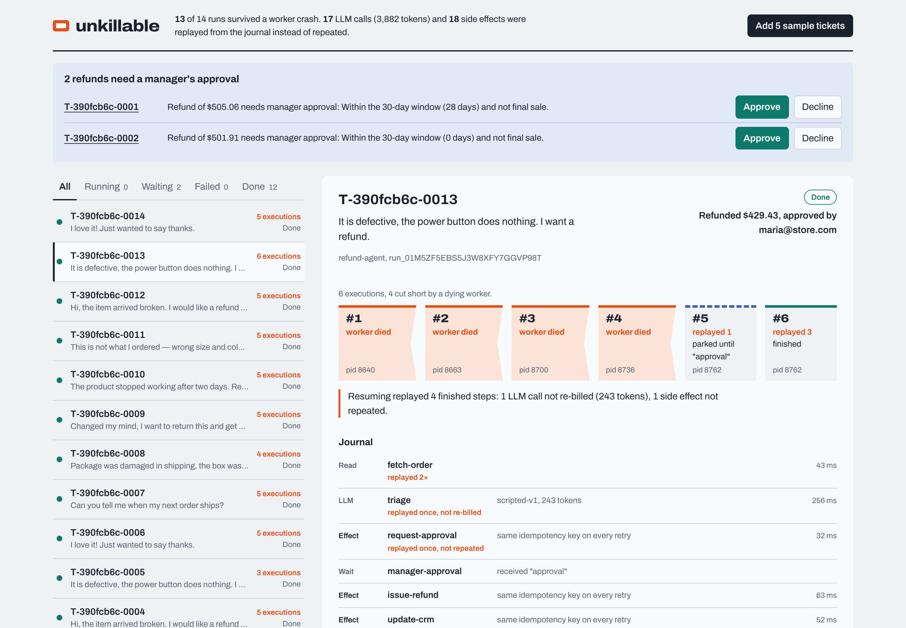
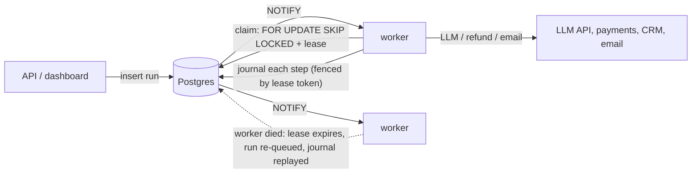

# unkillable

**AI agents that survive crashes without double-charging anyone.**

unkillable is a durable execution runtime for AI agents, built on nothing but Postgres. Every step an agent takes (a read, an LLM call, a refund, an email) is checkpointed. When a worker dies mid-run, another worker resumes the run from the journal: finished LLM calls aren't paid for again, and side effects aren't repeated.



## The problem

Agents in production are long-running, multi-step programs that touch real systems. A support agent reads an order, asks an LLM whether policy allows a refund, issues the refund, updates the CRM and emails the customer.

Workers die all the time: deploys, OOM kills, spot instances, autoscaling, timeouts. When an ordinary agent dies halfway through, the job is retried from the top. That retry:

- **pays for every LLM call again**, and
- **repeats side effects that already happened**: a second refund, a second email, a duplicate CRM note.

The usual fixes are to bolt on a workflow engine (Temporal, Step Functions) with new infrastructure and a new programming model, or to hand-roll checkpoint tables per agent. unkillable is the small, boring version: a library plus the Postgres you already run.

## The result

Same refund agent, same 200 support tickets, same crash pattern. Four worker processes; a chaos monkey SIGKILLs a random one every second, and workers also kill themselves right after side effects (the worst possible moment: refund sent, journal not yet updated). Managers approve large refunds as they come in. The sandboxed payments, CRM and email systems count what _actually_ happened.

|                                     |            naive agent |       **unkillable** |
| ----------------------------------- | ---------------------: | -------------------: |
| Support tickets                     |                    200 |                  200 |
| Workers SIGKILLed                   |                    124 |                   65 |
| …of which right after a side effect |                     64 |                   31 |
| Runs completed                      |                200/200 |              200/200 |
| Customers refunded twice            |                     83 |                **0** |
| Money refunded twice                |             $75,239.90 |            **$0.00** |
| Customers emailed twice             |                     53 |                **0** |
| Duplicate CRM notes                 |                    187 |                **0** |
| LLM calls (2 needed per ticket)     | 1,847 (9.2 per ticket) | 708 (3.5 per ticket) |
| Re-sent effects safely deduplicated |                      0 |                  166 |
| Wall time                           |                 61.8 s |               35.4 s |

The "naive agent" is the identical agent code with checkpointing turned off (`EXECUTION_MODE=naive`), running on the same queue with the same lease-based crash recovery. The only variable is the journal. Reproduce it with `pnpm bench` ([bench/chaos.ts](bench/chaos.ts)); the raw numbers are in [bench/results](bench/results). The naive agent gets killed more often only because it runs longer.

unkillable still makes more than 2 LLM calls per ticket because a call that is _in flight_ when its worker dies has no result to save, so it is made again. Only finished work can be replayed.

## How it works

You write a normal async function. Wrapping each operation in `ctx.*` makes it durable:

```ts
export const refundAgent = defineAgent({
  name: 'refund-agent',
  input: TicketSchema,
  async run(ctx, ticket) {
    const order = await ctx.step('fetch-order', () => orders.get(ticket.orderId))

    const decision = await ctx.llm('triage', {
      schema: DecisionSchema, // Zod-validated structured output, auto-repaired if invalid
      messages: [
        { role: 'system', content: POLICY },
        { role: 'user', content: ticket.message },
      ],
    })

    if (decision.amountCents > 20_000) {
      // the run parks here, holding no worker, until a manager approves in the dashboard
      const approval = await ctx.waitForEvent('manager-approval', 'approval', { timeoutMs: DAY })
      if (!approval?.payload.approved) return { decision: 'declined' }
    }

    // same idempotency key on every retry -> the payment API applies it exactly once
    await ctx.tool('issue-refund', (key) => payments.refund(order.id, decision.amountCents, key))
    const reply = await ctx.llm('draft-reply', { messages: replyPrompt(ticket, decision) })
    await ctx.tool('send-email', (key) => email.send(ticket.customerEmail, reply, key))
  },
})
```



- **Postgres is the queue.** Runs are claimed with `FOR UPDATE SKIP LOCKED`, so any number of workers share one table without blocking each other or double-claiming. `LISTEN/NOTIFY` wakes workers immediately, with polling as a fallback.
- **Leases with heartbeats.** A claimed run holds a lease that its worker renews every `LEASE_MS/3`. If a worker dies, the lease expires and the run returns to the queue.
- **Fencing tokens.** Every claim mints a new lease token, and every journal write checks it. A zombie worker (GC pause, network partition) that wakes up after its run was taken over cannot write anything.
- **Replay.** On re-execution, completed steps return their recorded result instantly, and the run continues from the first step that never finished. Step output is JSON-normalized on the _first_ execution too, so live and replayed runs see identical values.
- **Exactly-once effects.** `ctx.tool` hands your code an idempotency key derived from `(run, step)`, the same on every retry. Downstreams that honor idempotency keys (Stripe, most payment and email APIs) apply the effect exactly once. For downstreams that don't, `mode: 'at-most-once'` writes a marker first and, if a crash leaves the outcome unknown, stops the run for a human to resolve instead of guessing.
- **Determinism guard.** If replay hits a different step than the journal recorded at that position (code changed between executions, or the agent branched on `Date.now()` outside a step), the run fails with `non_determinism` instead of corrupting itself.
- **Durable waits.** `ctx.sleep` and `ctx.waitForEvent` release the worker entirely. Approvals are consumed and checkpointed in one transaction, so a crash can't eat one, and the classic lost-wakeup race is closed by row locks.

The full design, with trade-offs, is in [docs/DESIGN.md](docs/DESIGN.md).

## Quick start

With Docker:

```bash
docker compose up --build
open http://localhost:8080          # dashboard: click "Add 5 sample tickets"
docker compose up -d --scale worker=3
docker compose kill worker          # kill every worker, then bring them back:
docker compose up -d --scale worker=3
```

Runs that were mid-flight resume where they stopped. The dashboard tape shows each execution, cut where a worker died.

Without Docker (Node 22.18+ and any Postgres 13+, Neon's free tier included):

```bash
pnpm install
pnpm dashboard:build
pnpm sandbox &                                  # stand-in payments / CRM / email / LLM
DATABASE_URL=postgres://... pnpm start          # migrates, then serves API + worker on :8080
```

Everything runs free. By default the agent talks to a deterministic stand-in model, so demos and CI are reproducible and cost nothing. To use a real model, point at any OpenAI-compatible API, such as a local [Ollama](https://ollama.com):

```bash
ollama pull qwen2.5:7b
LLM_PROVIDER=openai LLM_BASE_URL=http://localhost:11434/v1 LLM_MODEL=qwen2.5:7b pnpm start
```

## API

Interactive OpenAPI docs are served at `/docs`. When `API_KEYS` is set, every `/v1` route needs `Authorization: Bearer <key>`.

| Endpoint                           | What it does                                                                                                                                     |
| ---------------------------------- | ------------------------------------------------------------------------------------------------------------------------------------------------ |
| `POST /v1/runs`                    | Start a run. Send an `Idempotency-Key` header so client retries never start the same work twice (a different body with a reused key gets `409`). |
| `GET /v1/runs`, `GET /v1/runs/:id` | List runs; read a run's journal, timeline and what replay saved.                                                                                 |
| `POST /v1/runs/:id/events`         | Deliver an event, such as a manager's approval, to a waiting run.                                                                                |
| `POST /v1/runs/:id/retry`          | Resume a failed run from the failed step. For an ambiguous side effect, say what happened: `assume_done` or `retry_effect`.                      |
| `POST /v1/runs/:id/cancel`         | Cancel a queued, waiting or running run.                                                                                                         |
| `GET /v1/approvals`                | Runs parked waiting for a human.                                                                                                                 |
| `GET /v1/stats`, `GET /metrics`    | Totals (crash recoveries, LLM calls and tokens saved) and Prometheus metrics.                                                                    |
| `GET /healthz`, `GET /readyz`      | Liveness and readiness (database reachable).                                                                                                     |

## Guarantees and limits

|                                       | Guarantee                                                                  |
| ------------------------------------- | -------------------------------------------------------------------------- |
| A completed step                      | Runs once; replayed from the journal afterwards.                           |
| A step in flight when its worker dies | Runs again. Its body is at-least-once, so make reads safe to repeat.       |
| `ctx.tool` (idempotent mode)          | Exactly-once _effect_, provided the downstream honors the idempotency key. |
| `ctx.tool` (at-most-once mode)        | Never repeated. An ambiguous crash stops the run for a human.              |
| A run that keeps killing workers      | Fails after `RUN_MAX_ATTEMPTS` instead of looping forever.                 |

The limits, stated plainly:

- **Agents must be deterministic between steps.** Read the time, randomness and external data inside `ctx.step`; deploying a code change mid-run is caught by the determinism guard.
- **Postgres sets the throughput ceiling.** A journal write per step suits agent workloads, where each step is an LLM or API call taking hundreds of milliseconds. It is not built for millions of tiny tasks per second.
- **Not a distributed-systems silver bullet.** Exactly-once effects come from idempotency keys plus a journal, and that only works when the downstream cooperates. This is why the at-most-once mode exists.

## Operating it

The [runbook](docs/RUNBOOK.md) covers scaling workers, reading the metrics, alerts worth setting, and handling failed or ambiguous runs. The [integration guide](docs/INTEGRATION.md) shows how to move an existing agent onto unkillable, including a checklist for which downstream calls need idempotency keys.

## Tests

```bash
pnpm test         # unit + integration against a real Postgres (31 tests)
pnpm test:chaos   # real worker processes, SIGKILLed mid-run; asserts zero duplicate effects
pnpm bench        # the naive-vs-unkillable table above
```

The integration suite covers crash recovery with a frozen "zombie" worker that is fenced out, nondeterminism detection, ambiguous at-most-once effects resolved by an operator, approvals that arrive before the agent waits for them, durable timers, structured-output repair, run-level retries that keep completed steps, and idempotent run creation. CI runs lint, typecheck, all suites (including chaos) against Postgres 17, and a Docker build on every push.

## Stack

- **Runtime:** Node 24 running TypeScript natively (type stripping, so there's no build step for the server), with TypeScript 7 for type checking.
- **Server:** Fastify 5, with Zod 4 for validation, structured LLM output and the OpenAPI spec.
- **Database:** Postgres through postgres.js; schema migrations are plain SQL.
- **Dashboard:** React 19, Vite 8 and TanStack Query.
- **LLM:** any OpenAI-compatible API (Ollama, OpenAI, Groq, vLLM), plus a deterministic stand-in model.
- **Tooling:** Biome 2, Vitest 5, Prometheus metrics, Docker and GitHub Actions.

```
src/runtime/   the durable runtime: context (step/llm/tool/sleep/waitForEvent), store, worker
src/api/       HTTP API + OpenAPI
src/llm/       OpenAI-compatible and scripted providers
src/demo/      the refund agent and its policy
src/sandbox/   stand-in payments / CRM / email / LLM that count real side effects
dashboard/     React dashboard
bench/         chaos benchmark
test/          unit, integration, chaos
```

## License

MIT
